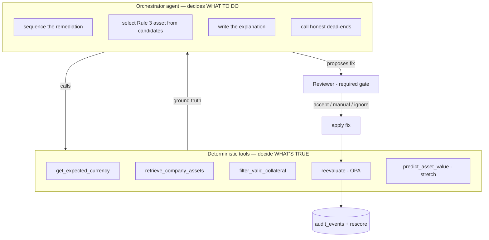
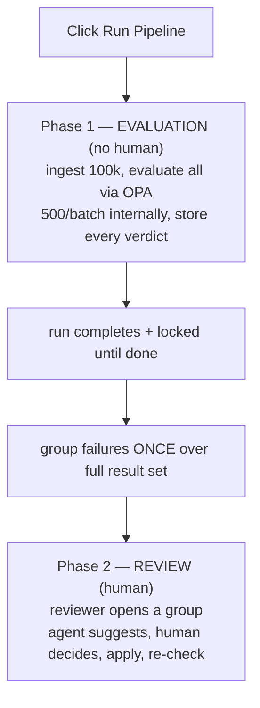
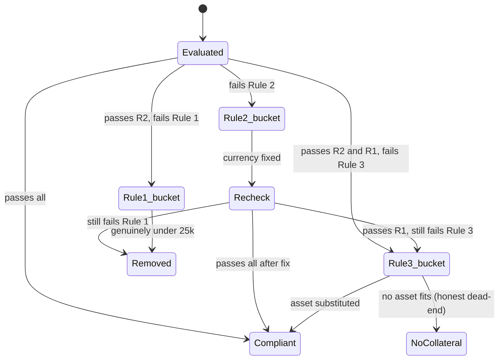
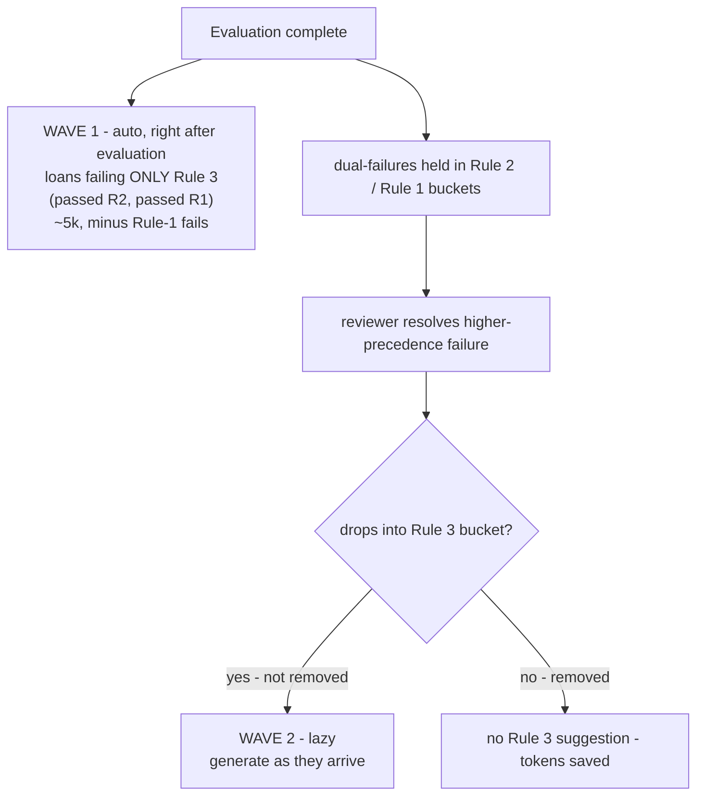

# Engine 2 — Action / Remediation Engine (Agentic)

> The remediation half of the loan-compliance system. Engine 1 produces a
> deterministic verdict for every loan; **Engine 2 turns each failure into a fix,
> puts a human in the loop, applies the accepted fix, and re-checks it through
> OPA.** It is **agentic** — an orchestrator agent drives the flow — but every
> verdict and every fix *value* is grounded in a deterministic tool. The agent
> decides *what to do*; the tools decide *what's true*.

This document assumes the [Engine 1 README](./ENGINE1_README.md) — the rules, the
OPA contract, the data model (`loans`, `rule_results`, `audit_events`, `run_meta`),
and the remediation ordering all carry over.

---

## Table of contents

1. [Design principle: agentic flow, deterministic tools](#1-principle)
2. [Where agency earns its place — and where it doesn't](#2-agency)
3. [Architecture: orchestrator + tools](#3-architecture)
4. [The tools](#4-tools)
5. [Two-phase runtime: evaluate fully, then review](#5-phasing)
6. [Precedence & the single-bucket model](#6-buckets)
7. [Rule 3 suggestion generation: two waves](#7-two-waves)
8. [Grouping / clubbing](#8-grouping)
9. [Human-in-the-loop gate](#9-hitl)
10. [Remediation ordering & re-check](#10-ordering)
11. [Audit logging](#11-audit)
12. [Runtime decisions & open forks](#12-forks)
13. [Data grounding](#13-data)
14. [Locked design decisions & rationale](#14-locked)

---

<a name="1-principle"></a>
## 1. Design principle: agentic flow, deterministic tools

The whole system rests on one boundary, and Engine 2 extends it:

- **The agent decides *what to do*** — how to sequence a remediation, which asset
  to suggest for Rule 3, when to give up honestly, and how to explain a fix to a
  reviewer.
- **Deterministic tools decide *what's true*** — the verdict (OPA), the correct
  currency (static table), the valid collateral candidates (a filter over the
  catalog), and the re-checked verdict after a fix (OPA again).

Every factual claim the agent makes traces to a tool call that can be logged and
replayed. The agent never invents a verdict or a fix value. This is the same
OPA-vs-model split from Engine 1, now wrapped in an agentic control flow — which
is what makes the system genuinely agentic *without* breaking the determinism the
brief grades hardest.

> **The one-sentence defense:** we made the system agentic exactly where there's a
> judgement to make, and deliberately kept it deterministic everywhere there's only
> a fact to look up — because agency without a decision to make is just
> non-determinism we'd have to defend for no benefit.

---

<a name="2-agency"></a>
## 2. Where agency earns its place — and where it doesn't

Agency was added by judgement, not reflex. Being able to state both halves — where
it helps and where it was deliberately withheld — is a core presentation point.

**Where agency produces a materially better result:**

- **Rule 3 asset selection.** The filter returns *which* assets clear the 50%
  threshold; often several do. The agent chooses *which one* to suggest (closest
  fit, largest margin, or one asset that resolves several of a company's loans) and
  **explains the trade-off**. This is judgement over a deterministic candidate set.
- **Branching remediation.** The flow has real branches (fix currency → re-check →
  maybe rescued → maybe still fails Rule 3 → maybe no asset fits → maybe the
  predictor). An agent given the tools and the goal handles this as reasoning
  rather than a brittle nested if-tree, and degrades gracefully on cases not
  explicitly coded.
- **Honest dead-ends.** When no asset fits, the agent reports "no adequate
  collateral exists" rather than forcing a suggestion — which the brief explicitly
  rewards.
- **Explanation quality at scale.** For a human who must *trust* a suggestion
  enough to bulk-approve hundreds, an adaptive, fact-cited explanation beats a
  template. Directly affects whether the review pass is fast or painful.

**Where agency buys nothing — kept deterministic on purpose:**

- **The verdict** — OPA only. An "agentic" pass/fail fails the brief.
- **The Rule 2 fix value** — the currency comes from the static table (already
  computed in Engine 1). Letting the model "decide" EUR is non-determinism with
  zero upside, and the exact anti-pattern the brief calls out.
- **Rule 1's removal decision** — post-re-check, it's a threshold comparison.
- **Grouping** — done deterministically by fix-signature; an LLM classifier here
  would just add variance.

**The caveat that makes all of this real:** every benefit above holds *only if the
agency produces traceable reasoning*. Agency you can trace beats determinism;
agency you can't trace loses to it. Every agent choice logs its reasoning and tool
calls so it can be reconstructed.

---

<a name="3-architecture"></a>
## 3. Architecture: orchestrator + tools



The agent appears in exactly one place in the pipeline (build + sequence the
remediation); everything factual routes through a tool; the human is a hard gate
before anything is applied.

---

<a name="4-tools"></a>
## 4. The tools

| Tool | Deterministic? | Returns | Used for |
|---|---|---|---|
| `get_expected_currency(company)` | Yes | The correct currency (static table) | Rule 2 fix *value* — never guessed |
| `retrieve_company_assets(company)` | Yes | The company's deduplicated asset catalog | Rule 3 retrieval (structured lookup) |
| `filter_valid_collateral(assets, loan_value)` | Yes | Assets clearing `>= 0.5 * loan_value` | Rule 3 *candidate set* |
| `reevaluate(loan)` | Yes (OPA) | Fresh verdict on all 3 rules | The re-check after any fix |
| `predict_asset_value(loan)` | Yes (model) | Estimated suitable asset value | **Stretch** — when no existing asset fits |

The agent orchestrates these; it does not replace them. Rule 1's "fix" (remove) and
Rule 2's fix (the table value) require no LLM at all — only Rule 3's *selection and
explanation* over the candidate set is genuine agent work.

---

<a name="5-phasing"></a>
## 5. Two-phase runtime: evaluate fully, then review

The batch of 500 (from Engine 1) is an **internal speed detail of evaluation**, not
a user-facing unit. "The pipeline" means the **whole CSV**. Evaluation and review
are **separate phases**, and they never overlap.



Why the phases must separate:

- **Grouping needs the whole dataset.** "312 German loans in USD → EUR" is only
  correct once every loan is seen; grouping on a partial set produces stale groups.
- **No approval-vs-pipeline queue.** If review started mid-evaluation, the pipeline
  and the reviewer would write concurrently, with stale groups and ordering
  hazards. Completing evaluation first eliminates this by construction.
- **The LLM must not run during evaluation.** Calling the agent per failing loan
  during evaluation would turn a sub-minute deterministic pass into hours. Suggestion
  generation belongs to the review phase (see [section 7](#7-two-waves)).

**On the brief:** it requires a suggestion be *available* for each failing rule; it
says nothing about *when* it is generated. Timing is our choice. The Rule 1 and Rule
2 fix values aren't LLM output (remove; table lookup), so they're ready trivially —
only Rule 3 generation has a real cost worth scheduling.

---

<a name="6-buckets"></a>
## 6. Precedence & the single-bucket model

Every failing loan lives in **exactly one active bucket at a time**, chosen by
precedence **Rule 2 → Rule 1 → Rule 3**. A loan failing several rules shows only in
its highest-precedence bucket. As each failure is resolved, the loan becomes
compliant, is removed, or **drops** to the next bucket.



Why this precedence (it is the Engine 1 remediation ordering):

- **Rule 2 first** — a currency fix can *flip* Rule 1 (the EUR figure depends on the
  currency label), so currency must be resolved before Rule 1 is judged.
- **Rule 1 second** — removal is terminal-after-re-check; no point running Rule 3 on
  a loan about to be removed. Note: a loan that *passes* Rule 2 but fails Rule 1 has
  no currency fix available to rescue it, so it is genuinely under EUR 25,000 →
  removed.
- **Rule 3 last** — the expensive LLM step, only for loans that survive the first two.

**The currency-invariance subtlety (don't let it bite the state machine):** a Rule 2
fix does **not** clear a Rule 3 failure — coverage is currency-invariant. So a loan
failing both will, after its currency fix, *still* fail Rule 3 unless it was removed
by a Rule 1 flip. This means a loan can legitimately traverse **two** buckets over
its lifecycle (Rule 2, then Rule 3). That is not the same as "appearing in two groups
at once" — it is in one *active* bucket at any moment. This is how "each row appears
once" stays true without breaking the flow.

---

<a name="7-two-waves"></a>
## 7. Rule 3 suggestion generation: two waves

Rule 3 suggestions are auto-generated (with a "generating suggestions…" progress
bar) — but **only for loans actually in the Rule 3 bucket**, never for loans still
behind Rule 2 or Rule 1. Generating for the wrong loans wastes tokens and, worse,
generates for loans that may be removed.



- **Wave 1 (auto, at evaluation-end):** the *settled* Rule-3-only bucket — loans that
  passed Rule 2 and Rule 1 and fail only Rule 3. Nothing upstream will move them, so
  they can be batch-generated safely with the progress bar.
- **Wave 2 (lazy, on resolution):** dual-failures that drop into the Rule 3 bucket
  after their Rule 2 / Rule 1 resolution. Smaller, generated as they arrive.

**The token-waste guard:** never generate a Rule 3 suggestion for a loan whose
post-currency-fix Rule 1 verdict is fail → removed. Bucketing by precedence gives
this for free — a removal-bound loan never reaches the Rule 3 bucket. The saving is
specifically the *removal-bound* subset (a Rule 2 fix alone does not clear Rule 3, so
non-removed dual-failures still need their suggestion eventually).

> **Measure before committing Wave 1 size.** Rule 1 needs live FX, so the exact
> Wave-1 count = (Rule-3-only loans) minus (those also failing Rule 1). Benchmark on
> day 2 once FX is wired. The logic holds regardless; only the batch size moves.

---

<a name="8-grouping"></a>
## 8. Grouping / clubbing

Grouping is **deterministic by fix-signature; explanation is agentic.** The group key
*is* the classification — no LLM classifier, so grouping is reproducible.

| Rule | Groups by | Clubs well? |
|---|---|---|
| Rule 1 | single "remove" group | Perfectly — one bulk action |
| Rule 2 | `expected_currency` (or company) | Well — "312 German loans in USD → EUR" |
| Rule 3 | mostly per-loan; occasionally same-company-same-substitute | Mostly not |

The agent writes **one explanation per group**; the reviewer approves the group in
one action. **Preserve the per-loan audit trail:** a bulk approval is one human
decision covering N loans, but the log must still reconstruct per loan (N events, or
one grouped event naming all N `loan_id`s). Clubbing batches the click, never erases
the trail.

---

<a name="9-hitl"></a>
## 9. Human-in-the-loop gate

The brief mandates a human decides. The agent **proposes**, never **applies**.

```
Agent builds suggestion (fix value from tool, explanation from LLM)
        │
        ▼
Reviewer: accept (bulk/single) / fix manually / ignore   ← required human gate
        │
        ▼ (on accept)
apply fix → reevaluate() through OPA → persist new verdict
        │
        ▼
audit event per loan + recompute compliance score
```

The agent may run right up to the suggestion and right after the human's decision
(applying, re-checking) — but the decision itself is always human. Any auto-heal-style
convenience is framed "suggested, pending confirmation," never "applied
automatically" — auto-applying safe fixes without a human (as some reference pipelines
do) would break the brief's one hard requirement.

---

<a name="10-ordering"></a>
## 10. Remediation ordering & re-check

Carried from Engine 1, enforced here as the orchestrator's control flow:

1. **Fix currency first** (Rule 2), if it failed — because it can flip Rule 1.
2. **Re-evaluate the whole loan through OPA** — all three rules, never just the fixed
   one. A fix to one rule can move another.
3. **Then decide removal** (Rule 1) — a loan failing Rule 1 at evaluation may be
   *rescued* by the currency fix; only a loan still failing after re-check is removed.
4. **Then handle Rule 3** — currency-invariant, so unaffected by the currency fix.

The verdict after a fix comes from OPA again, never from "we assume the fix worked."
Even the post-fix state traces to a Rego decision.

---

<a name="11-audit"></a>
## 11. Audit logging

Engine 2 writes `source='reviewer'` and agent-action events into the shared
`audit_events` log (Engine 1 data model).

- **Log what happened, never what was suggested.** A suggestion is ephemeral — shown
  in the UI. Only when the reviewer *accepts* it does that acceptance become an event.
  Every log line is a fact (an OPA verdict or a human decision), not a probabilistic
  proposal.
- **Capture the applied change inside the action event** — e.g.
  `reviewer · L000123 · accepted_ai_fix · {rule: 2, from: "USD", to: "EUR"}`. The
  suggestion isn't its own event, but the committed value is a recorded fact.
- **Free suggestion-quality metric.** The per-rule rate at which reviewers *accepted*
  the AI fix (vs fixed manually or ignored) is a human-validated quality signal,
  derived entirely from action events without ever logging a suggestion.
- **Log the agent's reasoning trace** for Rule 3 selections, so any "why this asset"
  can be reconstructed — this is what keeps the agency traceable.

---

<a name="12-forks"></a>
## 12. Runtime decisions & open forks

### Decided — LLM provider

**Grok now → OpenAI / Azure OpenAI later, behind one interface.** No OpenAI/Azure
credentials at build start, so Grok is the stand-in. What makes this safe is the
abstraction, not Grok itself: every model call goes through a single thin seam
(`llm.complete(messages)`), so switching provider is a config change (base URL, key,
model name), not a rewrite. Grok exposes an OpenAI-compatible API, so coding against
the OpenAI client shape now makes the later swap mostly mechanical.

- **No provider quirks leak past the seam.** Prompt-building, tool-call parsing, and
  retry/timeout logic live on our side of the interface; nothing downstream knows
  which provider answered.
- **Deployment answer ready:** "Grok is a build-time stand-in; the provider is
  abstracted behind one interface, so production maps to Azure OpenAI — where BIL
  runs — with a config change." Turns a scrappy choice into evidence of deployment
  thinking.
- **Tune Rule 3 prompts on the demo model.** Whichever model presents is the one
  whose explanation quality judges see — if presenting on Grok, tune and test the
  Rule 3 prompts on Grok, since output style and reliability differ by provider.
- **Build the seam first.** `llm.complete()` against Grok with a trivial prompt is
  the first thing built in Engine 2, before any agent logic — everything calls
  through it.

### Decided — framework: LangGraph

LangGraph fits this shape exactly: a graph of tool/reasoning nodes with the
human-in-the-loop as an **interrupt** (which it is purpose-built for). It also
implements the design we already have rather than adding a new one — the
constrained-orchestrator flow *is* a small LangGraph: the fix → re-check ordering
becomes the graph's edges, the HITL gate becomes the interrupt primitive, and each
tool is a node calling our deterministic function.

- **The hard rule:** keep the graph simple and legible — nodes map one-to-one to the
  steps in this doc (suggest → human interrupt → apply → re-evaluate), each node's
  logic being *our* code. LangGraph wires the steps together; it does not make
  decisions. The failure mode in an assessment is a node nobody can explain when a
  judge points at it.
- **Spike the interrupt early.** A short Day-1 spike to confirm LangGraph's
  interrupt/checkpoint behaves as expected for the group-gated review flow, since the
  whole review phase hangs off it.

### Still open — two design forks

Set to recommended defaults below; flagged for the team to confirm, since they change
scope:

- **Sequencing agency (recommended: constrained).** A fixed high-level remediation
  flow (fix currency → re-check → decide removal → Rule 3 selection), with the agent's
  real reasoning concentrated at Rule 3. The alternative — a freer agent reasoning out
  the order each time — is more autonomous but enlarges the "explain every part"
  surface and can make runs differ. Constrained is fully traceable and still agentic
  where it counts.
- **Topology (recommended: single orchestrator).** One orchestrator calling tools,
  versus a multi-agent graph (separate retrieval / suggestion / verification agents).
  Multi-agent looks more impressive but multiplies what every team member must
  explain. For 3–4 people over 4 days, a single well-understood orchestrator is the
  stronger showing.

---

<a name="13-data"></a>
## 13. Data grounding

Measured directly from `loans.csv` (100,000 rows). Rule 2 and Rule 3 need no live FX,
so these are exact; Rule 1 needs FX and is measured at run time.

| Segment | Count |
|---|---|
| Total loans | 100,000 |
| Fail Rule 2 (currency mismatch) | 7,179 (7.2%) |
| Fail Rule 3 (under-collateralised) | 6,181 (6.2%) |
| Fail **both** Rule 2 and Rule 3 | 1,116 |
| Fail Rule 2 **only** | 6,063 |
| Fail Rule 3 **only** (→ Wave 1 candidate, modulo Rule 1) | 5,065 |

Reading: ~5,065 loans are cleanly in the Rule 3 bucket at evaluation-end (Wave 1,
before subtracting any that also fail Rule 1); the 1,116 dual-failures are held behind
Rule 2 and generate lazily (Wave 2) only if they survive to the Rule 3 bucket.

---

<a name="14-locked"></a>
## 14. Locked design decisions & rationale

| # | Decision | Rationale |
|---|---|---|
| 1 | Agentic control flow wrapping deterministic tools | Genuinely agentic without making verdicts/fix-values non-deterministic |
| 2 | Agent decides *what to do*; tools decide *what's true* | Every factual claim traces to a replayable tool call |
| 3 | LLM work confined to Rule 3 selection + explanation | Rule 1 (remove) and Rule 2 (table) fix values need no model |
| 4 | Evaluation and review are separate, non-overlapping phases | Grouping needs the full dataset; avoids approval-vs-pipeline concurrency |
| 5 | The 500-batch is internal to evaluation, not a user-facing unit | "The pipeline" = whole CSV; batch is a speed detail |
| 6 | LLM never runs during evaluation | Per-loan LLM calls would turn a sub-minute pass into hours |
| 7 | Single-bucket precedence: Rule 2 → Rule 1 → Rule 3 | Matches remediation ordering; each row in one active bucket |
| 8 | Rule 3 generation in two waves (auto settled, lazy dual-failures) | Auto progress bar without wasting tokens on non-settled loans |
| 9 | Never generate Rule 3 for removal-bound loans | Bucketing gives this free; the real token saving |
| 10 | A loan may traverse two buckets over its lifecycle | Rule 2 fix doesn't clear Rule 3 (currency-invariant); still "appears once" active |
| 11 | Deterministic grouping by fix-signature; agentic explanation | Reproducible groups; LLM only narrates |
| 12 | Preserve per-loan audit trail under bulk approval | One human decision, N reconstructable loan records |
| 13 | Agent proposes, human applies; no silent auto-heal | Brief mandates human in the loop |
| 14 | Re-run all rules through OPA after any fix | A Rule 2 fix can flip Rule 1; never re-check just the fixed rule |
| 15 | Log what happened, not what was suggested; capture applied value | Facts only in the log; yields a free suggestion-acceptance metric |
| 16 | Log the agent's reasoning trace | Agency you can't trace loses to determinism |
| 17 | LLM behind one `llm.complete()` seam; Grok now → Azure OpenAI later | Provider is a config swap; maps to BIL's Azure in prod; no quirks leak past the interface |
| 18 | Tune Rule 3 prompts on whichever model presents | Explanation quality judges see is the demo model's; style/reliability differ by provider |
| 19 | LangGraph as legible plumbing; nodes are our code, one-to-one with doc steps | Framework wires steps, doesn't decide; every node must be explainable to a judge |

---

### Relationship to Engine 1

Engine 1 stops at "every loan has a verdict and the run is logged." Engine 2 begins
there: group the failures, suggest fixes (deterministic values, agentic Rule 3
selection + explanation), gate on a human, apply, re-check through OPA, and move the
compliance score. Together they are one system with a single clean seam — the
`rule_results` and `audit_events` tables — and one consistent boundary: **OPA and the
static tools decide what's true; the agent decides what to do about it.**
