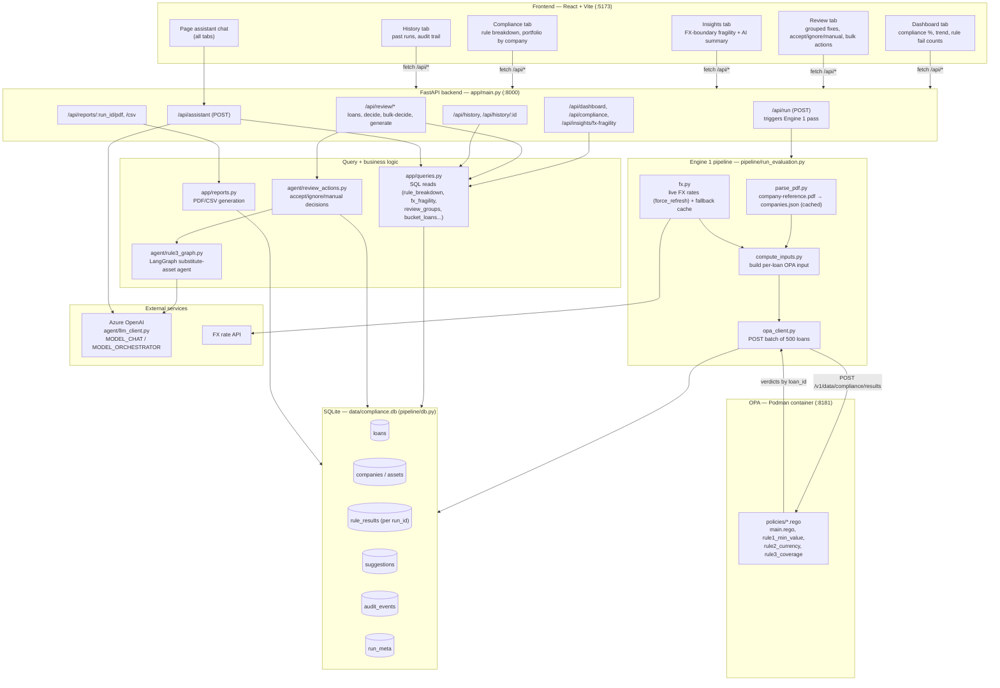

# BIL Loan Approver — Architecture Overview

Full architecture traced from the code (frontend → API → pipeline/agent → DB/OPA).

## Key structural notes

- **Frontend** (`frontend/src/App.jsx`): single-page app, 5 tabs, calls `/api/*`
  in parallel via `loadAllData()`, proxied by Vite to `:8000`.
- **Backend** (`backend/app/main.py`): one FastAPI app, thin route layer —
  all real logic lives in `queries.py` (reads) and `review_actions.py`
  (writes/decisions).
- **Engine 1 pipeline** (`backend/pipeline/run_evaluation.py`): streams
  `loans.csv`, batches 500 loans per OPA call, persists incrementally —
  never loads the whole dataset into memory.
- **OPA** (`docker-compose.yml`): runs as a Podman container, policies
  mounted read-only from `backend/policies`, evaluated as pure Rego rules
  (rule1 = min value, rule2 = currency match, rule3 = coverage ratio).
- **DB** (`backend/pipeline/db.py`): SQLite, keyed by `(loan_id, run_id)` so
  history isn't overwritten across runs; `audit_events` is the append-only
  timeline.
- **Agent layer**: only Rule 3 (asset substitution) and the
  assistant/insights narration touch the LLM (`backend/agent/llm_client.py`)
  — Rules 1/2 are fully deterministic.
