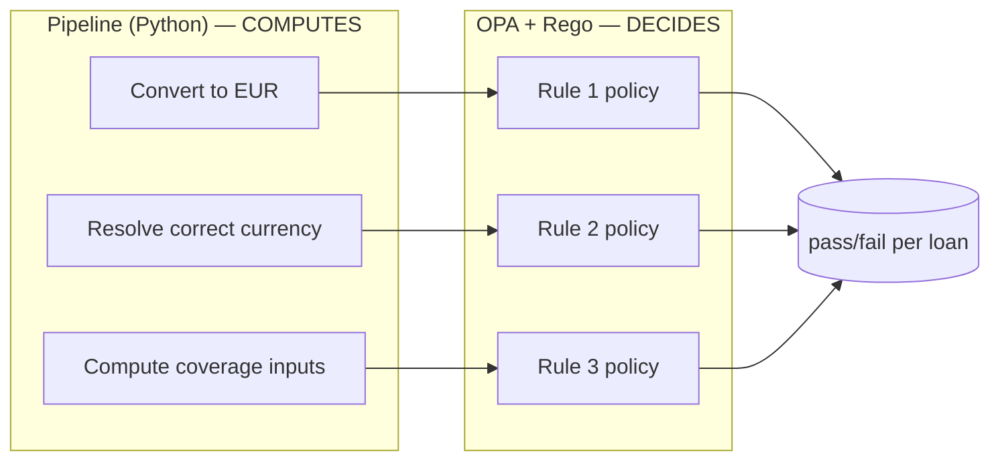
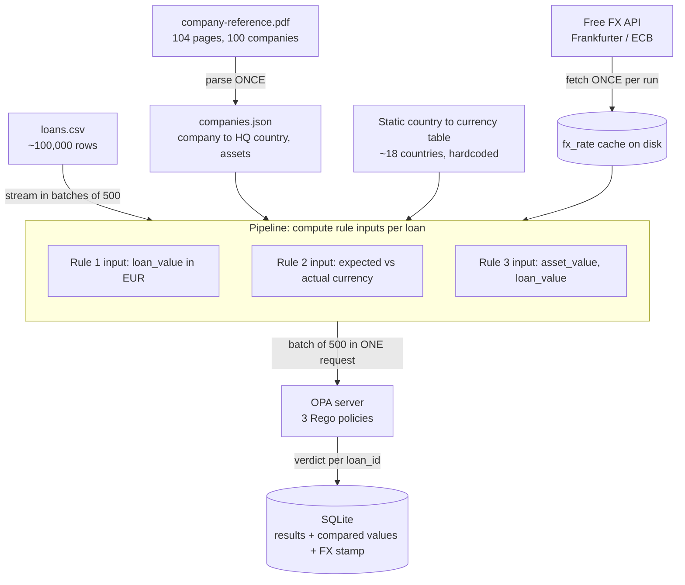
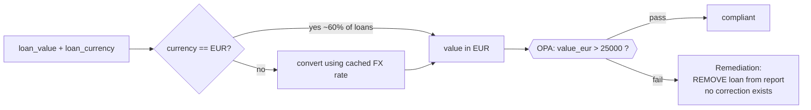
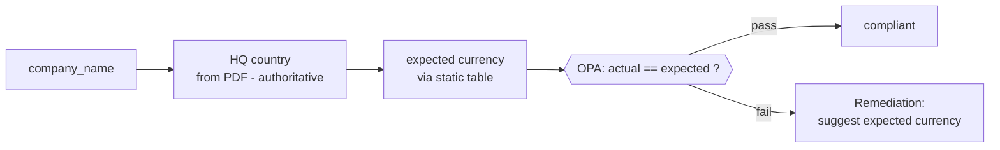
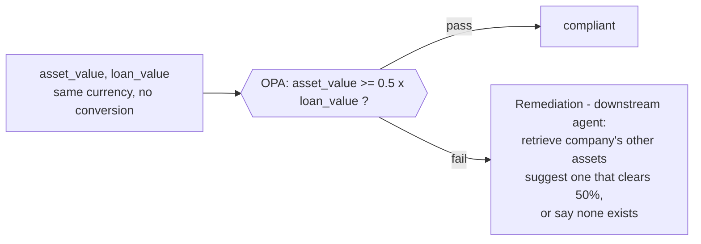
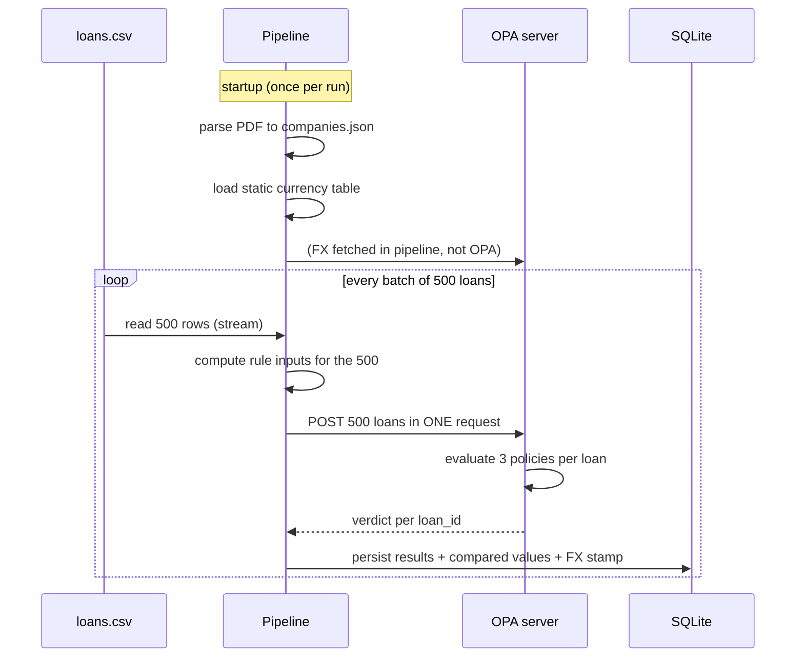
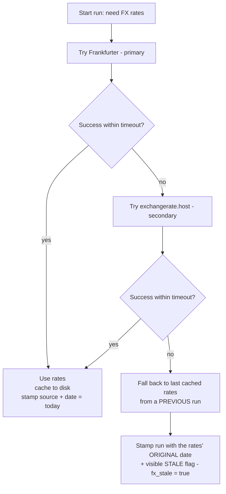
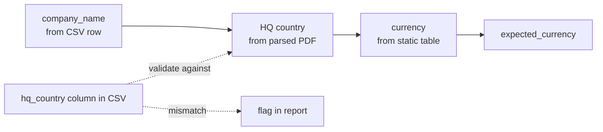
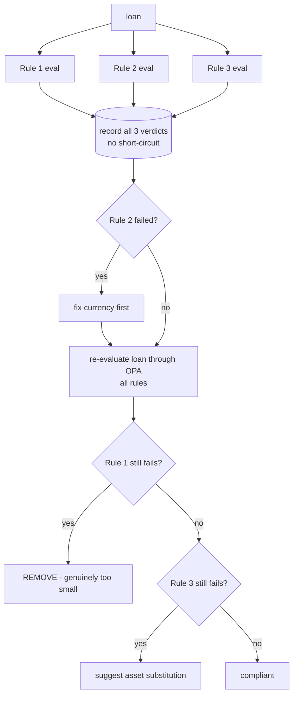
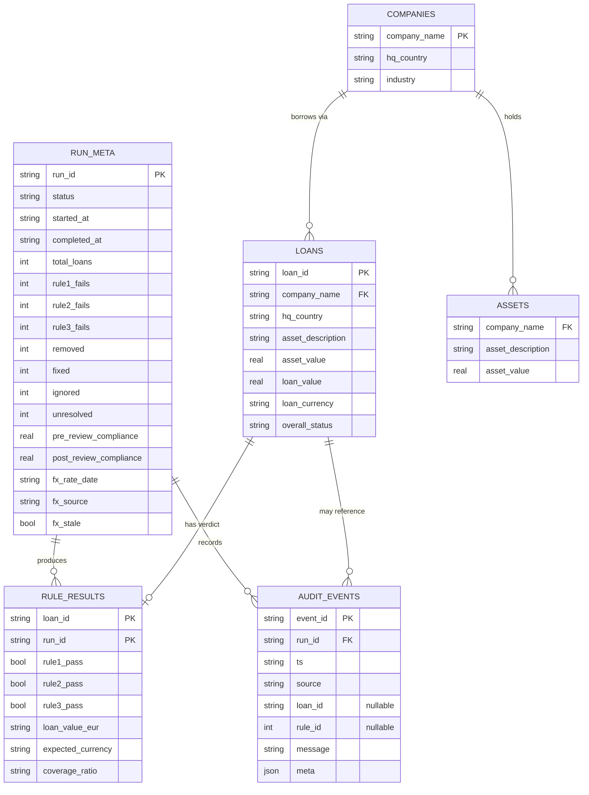

# Engine 1 — Compliance / Decision Engine

> The deterministic core of the loan-compliance system. It reads ~100,000 loans,
> computes the inputs each rule needs, and asks **OPA (Open Policy Agent)** for a
> pass/fail verdict on three rules. It does **not** suggest fixes and it does
> **not** involve a human — that happens downstream. This engine's only job is a
> fast, deterministic, fully-traceable verdict for every loan.

---

## Table of contents

1. [Design principle: OPA decides, the pipeline computes](#1-design-principle)
2. [High-level architecture](#2-high-level-architecture)
3. [The three rules](#3-the-three-rules)
4. [Processing flow (batch + streaming)](#4-processing-flow)
5. [FX handling and the stale-rate fallback](#5-fx-handling)
6. [Currency resolution (Rule 2 lookup chain)](#6-currency-resolution)
7. [OPA batching & the Rego contract](#7-opa-batching)
8. [Rule interactions & remediation](#8-rule-interactions)
9. [Assets: catalog, not allocation ledger](#9-asset-catalog)
10. [Data model (SQLite)](#10-data-model)
11. [Testing strategy](#11-testing)
12. [Locked design decisions & rationale](#12-locked-decisions)

---

<a name="1-design-principle"></a>
## 1. Design principle: OPA decides, the pipeline computes

The single most important boundary in this system:

- **The pipeline computes.** All gathering, conversion, and lookup happens in our
  Python pipeline: fetching the FX rate, converting currencies, deriving the
  correct currency for a company, computing the asset-coverage ratio.
- **OPA decides.** OPA receives numbers that are already prepared and only
  performs the comparison the rule specifies. It never touches the network, never
  does currency math, never makes a judgement call.

This keeps every verdict **deterministic** (same inputs → same output, always)
and **traceable** (every pass/fail maps to a specific ~5-line Rego policy a judge
can read). It is also the boundary we must be able to defend on demand:
**OPA = deterministic verdict; the downstream agent = probabilistic explanation
and fix suggestion.**



---

<a name="2-high-level-architecture"></a>
## 2. High-level architecture



Three things are prepared **once per run** and reused for every loan — never
recomputed per row:

| Prepared once | Why it never changes within a run |
|---|---|
| `companies.json` (parsed PDF) | The reference document is static |
| Country → currency table | The mapping is fixed; hardcoded by hand |
| FX rate(s) for the day | One rate set applies to the whole run |

---

<a name="3-the-three-rules"></a>
## 3. The three rules

All three are **deterministic** and all three verdicts come from OPA. They are
evaluated **independently** on every loan — we do *not* stop at the first
failure, because the report requires a **per-rule** breakdown and a single loan
can fail more than one rule.

> **Boundaries go opposite ways — read each rule's wording.** Rule 1 is
> *more than* (`>`, strict): a loan at exactly EUR 25,000.00 **fails**. Rule 3 is
> *at least* (`>=`): coverage at exactly 50% **passes**. Most teams assume the two
> thresholds behave the same; they don't, and the exactly-on-the-line test for each
> is the sharpest low-effort signal that the rules were read, not guessed.
>
> **Money is `Decimal`, 2dp, never float.** All monetary values are handled as
> `Decimal` to two decimal places. FX-converted figures are rounded to 2dp with
> `ROUND_HALF_UP` *before* the comparison. Float would drift exactly at the Rule 1
> boundary, which is where determinism is graded.

### Rule 1 — Minimum loan value

> A loan must be worth **more than EUR 25,000**. Non-EUR loans are converted to
> EUR at the day's rate before comparison.



- **Pipeline computes:** `loan_value_eur`. ~60% of loans are already EUR (no
  conversion); only the 7 non-EUR currencies use the cached rate.
- **OPA compares:** `loan_value_eur > 25000.00` (strict — exactly 25,000.00 fails).
- **Remediation:** the loan is out of scope for reporting — there is nothing to
  correct, so the fix is to **remove it**.

### Rule 2 — Currency must match HQ country

> A loan must be reported in the **currency of the country where the borrowing
> company is headquartered**.



- **Pipeline computes:** `expected_currency` via the lookup chain
  (see [section 6](#6-currency-resolution)).
- **OPA compares:** `actual_currency == expected_currency`.
- **Remediation:** propose the correct currency (e.g. a Germany-HQ loan reported
  in USD → suggest EUR).

### Rule 3 — Asset coverage

> The pledged asset's value must be **at least 50% of the loan value**
> (`asset_value >= 0.5 * loan_value`, both already in the same currency).



- **Pipeline computes:** just passes the two values (no conversion needed).
- **OPA compares:** `asset_value >= 0.5 * loan_value`.
- **Remediation:** handled by the downstream suggestion agent — retrieve the
  company's asset list from the parsed reference and propose a real alternative
  asset that satisfies the threshold, or honestly report that none does. **This
  is the one place retrieval matters** and where the "R" in RAG lives.

> **Note on data traps:** `asset_owner` is deliberate noise — no rule checks it.
> Do not normalise or chase it.

---

<a name="4-processing-flow"></a>
## 4. Processing flow (batch + streaming)

We never load all 100k rows into memory. The CSV is streamed in batches of 500;
each batch of 500 is the *same* 500 sent to OPA in a single request. One batch
size, end to end.



Ingestion is **validate, don't clean**: coerce types, strip `\r\n` line endings,
trim join keys — but never alter business values (currencies, amounts). The
violations are the thing the system exists to detect; cleaning them away would
defeat the assessment.

---

<a name="5-fx-handling"></a>
## 5. FX handling and the stale-rate fallback

Rule 1 depends on a live external FX rate — which the brief explicitly says is
partly testing how we handle an external dependency that can be slow or
unavailable.

- **Two sources, ordered.** Frankfurter (ECB-based) is primary; exchangerate.host
  is secondary. If the primary times out, we try the secondary before giving up.
- **Fetch once per run.** A single response returns all the rates we need (all 7
  non-EUR currencies against an EUR base). Cache it to disk.
- **Reuse for the whole run.** Never call an API per loan.
- **Record what was used.** The rate values, their date, *and which source
  supplied them* are stamped into the run, so any borderline Rule 1 verdict is
  reproducible and explainable ("today's rates came from the secondary because the
  primary timed out").

**Fallback chain when a fetch fails:**



The key is that staleness is **never silent**. A borderline loan judged on an old
rate is always accompanied by the rate's real date and a stale flag, so "why did
this pass yesterday and fail today?" always has an answer.

---

<a name="6-currency-resolution"></a>
## 6. Currency resolution (Rule 2 lookup chain)

Deriving the "correct" currency is two chained lookups, not one:



**Authority decision:** the PDF is the reference document, so the PDF's HQ country
is authoritative. The CSV's `hq_country` column is validated against it.

**Verified against the data:** all 100 companies in `loans.csv` appear in the PDF,
each has exactly one country in the CSV, and the CSV `hq_country` **agrees with the
PDF for all 100 — zero mismatches, zero orphans**. So on the given data the two
never disagree. We still keep a defensive branch: use the PDF, fall back to the
CSV `hq_country` if a company is ever missing from the PDF, and **flag** any
CSV-vs-PDF disagreement as a finding rather than silently resolving it. This
matters because a judge may hand over a modified row at demo time — "I checked,
they agree, and here's my fallback if that ever breaks" is stronger than trusting
either source blindly.

**Static country → currency table (built by hand from the 18 countries in the
data):**

| Currency | Countries |
|---|---|
| EUR | Germany, Ireland, Spain, France, Italy, Netherlands, Portugal, Austria, Belgium, Finland, Luxembourg |
| CHF | Switzerland |
| USD | United States |
| GBP | United Kingdom |
| SEK | Sweden |
| CAD | Canada |
| PLN | Poland |
| JPY | Japan |

Building this by hand (rather than querying a service or an LLM per row) is
deliberate: the mapping never changes at runtime, so a static table is faster,
deterministic, and free.

---

<a name="7-opa-batching"></a>
## 7. OPA batching & the Rego contract

**We send a batch of 500 loans to OPA in one request, not one loan per request.**

The evaluation work (three tiny comparisons) is microseconds — the real cost is
the **per-request HTTP round-trip overhead**. At 100k loans:

| Approach | OPA round trips | Result |
|---|---|---|
| One loan per request | ~100,000 | overhead dominates — minutes of pure plumbing |
| Batch of 500 | ~200 | round-trip tax paid 0.2% as often |

**The one bug-prone spot:** each result in the response must carry its own
`loan_id`. We map verdicts back by `loan_id`, never by array order.

**Batch size is a curve, not "bigger is better."** 500 is big enough to amortise
round-trip overhead, small enough to keep the JSON payload and per-request
blast-radius manageable — and it matches the CSV read batch. A single 100k-row
request would swing back to huge payloads and total loss on one failure.

**Why HTTP at all (vs embedding OPA in-process):** the server model keeps the
rule engine cleanly separated as its own inspectable, swappable service, and
batched HTTP is more than fast enough at this scale. Embedding would trade that
separation for speed we don't need.

### Three files, one package, one call

Each rule lives in **its own `.rego` file** — segregation of duties, so a judge can
read one rule in complete isolation and each is independently testable and
ownable. All three files sit under **one package** (`compliance`), and an
aggregating rule exposes them at a single path, so a batch is still **one query**,
not three. Number of files is a code-organisation choice; number of calls is a
query choice — they are independent.

```
policies/
  rule1_min_value.rego     # package compliance  — more-than-25k check
  rule2_currency.rego      # package compliance  — currency == expected
  rule3_coverage.rego      # package compliance  — asset >= 50% of loan
  main.rego                # package compliance  — aggregates all three per loan
```

### What OPA returns: verdict + the value it actually computes

OPA returns the boolean **plus the figure it genuinely computes** — not an echo of
the inputs the pipeline sent it (the pipeline already has those). For Rule 3 that's
the coverage ratio (OPA does the `asset_value / loan_value` comparison, so the
ratio is its own output); for Rules 1 and 2 the verdict is the substance, so it
returns the threshold / expected value it applied. This keeps each verdict
self-describing for downstream context without redundancy.

### Input (one batch)

```json
{
  "loans": [
    {
      "loan_id": "L000001",
      "loan_value_eur": 3271637.00,
      "actual_currency": "EUR",
      "expected_currency": "EUR",
      "asset_value": 2140704.00,
      "loan_value": 3271637.00
    }
  ]
}
```

> **Two value fields on purpose.** `loan_value_eur` (pipeline-converted) is used
> **only** by Rule 1. `loan_value` (original currency) is used by Rule 3 alongside
> `asset_value` — same currency, no conversion. Confusing these two is the easiest
> silent bug in the engine, so they are separate fields.

### Output (per `loan_id`)

```json
{
  "L000001": {
    "rule1": { "pass": true,  "threshold_eur": 25000.00 },
    "rule2": { "pass": true,  "expected": "EUR" },
    "rule3": { "pass": false, "coverage_ratio": 0.42, "required": 0.50 }
  }
}
```

The exact operators, which the policies encode and the tests pin:

| Rule | Pass condition | Boundary behaviour |
|---|---|---|
| Rule 1 | `loan_value_eur > 25000.00` | *more than* — exactly 25,000.00 **fails** |
| Rule 2 | `actual_currency == expected_currency` | exact string equality |
| Rule 3 | `asset_value >= 0.5 * loan_value` | *at least* — exactly 50% **passes** |

---

<a name="8-rule-interactions"></a>
## 8. Rule interactions & remediation

The three rules relate to each other differently depending on which layer you're
looking at. Keeping these two layers separate is the single most important thing
to get right — and the thing most likely to be probed in the presentation.

### Two layers, two different answers

- **Evaluation layer — all three rules are parallel.** Each rule is computed from
  independent inputs; none needs another's result. They are evaluated
  simultaneously (a single OPA batch call), and **every** failure is recorded for
  every loan — we never short-circuit, because the report needs an honest per-rule
  breakdown and a single loan can fail more than one rule.
- **Remediation layer — Rule 1 removal is terminal, but only *after* a re-check.**
  Rule 1's fix is *remove the loan from the report* (it is out of scope; there is
  nothing to correct). But a Rule 1 failure at evaluation is not automatically a
  real one: a mislabelled currency can make a loan *look* too small. So removal is
  decided **after** the currency is corrected and the loan is re-evaluated — not at
  evaluation time. Rules 2 and 3 are **correctable** and independent of each other.

> **Why the order matters — a Rule 2 fix can flip Rule 1.** Rule 1 is measured in
> EUR, and the EUR figure depends on the currency label. Example: a German company
> with a 27,000 **USD** loan converts to ~24,840 EUR → *fails* Rule 1 (looks under
> 25k) and *fails* Rule 2 (wrong currency). Fix the currency to EUR and the loan is
> 27,000 EUR, no conversion → 27,000 > 25,000 → **Rule 1 now passes.** The loan was
> never genuinely too small; it only looked that way in dollars. So we must fix the
> currency and re-evaluate *before* concluding a loan is out of scope.
>
> (Contrast: a Rule 2 fix does **not** move Rule 3 — coverage is currency-invariant,
> since asset and loan are in the same currency. Rule 2 can flip Rule 1, never
> Rule 3.)



Evaluation (top) is fully parallel — three checks firing at once. Remediation
(bottom) has an **order**: fix the currency, re-evaluate, *then* decide removal,
*then* handle any remaining Rule 3 failure. **"Sequential" only ever describes
remediation, never evaluation.**

### Remediation logic

```
# fix the currency first, because it can change Rule 1's answer
if rule2_fail:
    fix_currency()
    re_evaluate_through_OPA()      # all rules, fresh verdict

# now decide on the re-checked loan
if rule1_fail_after_recheck:
    action = REMOVE                # genuinely too small, even in the right currency
else:
    if rule3_fail_after_recheck:
        suggest_asset_fix()        # coverage was never affected by the currency fix
```

Key change from a naive design: **removal is decided after the re-check, not at
evaluation.** A loan failing Rule 1 at evaluation may be *rescued* by the currency
fix, so we never remove on the raw evaluation verdict alone.

### Facts worth being able to state on demand

- **A Rule 1 failure at evaluation is not always a real one.** A wrong currency can
  make a loan look too small; the currency fix can push it back over EUR 25,000. So
  we fix currency and re-evaluate before removing anything.
- **"Removed" is a post-review status, not an evaluation status.** The report's
  removal count comes from the final state after re-check, and will be *lower* than
  the raw Rule 1 evaluation-failure count by exactly the number of loans rescued by
  a currency fix. Being able to explain that gap — e.g. "47 failed Rule 1 at
  evaluation, 5 were rescued by currency fixes, so 42 were actually removed" — is a
  strong point to make to a judge.
- **A loan can need both a Rule 2 and a Rule 3 fix at once.** The review app must
  not assume one failure per loan.
- **A Rule 2 fix can flip Rule 1 but never Rule 3.** Rule 1's EUR figure depends on
  the currency label, so relabelling can change it. Rule 3 compares `asset_value` to
  `loan_value` in the *same* currency, so the ratio is currency-invariant and
  unaffected. This is why we re-run *all* rules after a fix rather than just the one
  that was fixed.

---

<a name="9-asset-catalog"></a>
## 9. Assets: catalog, not allocation ledger

A company typically has multiple loans and a small set of pledgeable assets. A
natural question is whether Rule 3's "suggest another asset" remediation must
avoid proposing an asset that is *already pledged* to another of the company's
loans (double-pledging).

**Decision: no — we treat the company's asset list as a catalog of available
collateral, not a one-asset-per-loan allocation ledger.**

The reference data supports this directly. The reference material lists, per
company, the distinct assets it *can* pledge with their values — it does **not**
contain any field marking an asset as "already committed" to a loan. The
`asset_owner` column that might look like allocation state is explicitly noise:
the same physical asset appears recorded under different related entities (the
company itself, subsidiaries, holding entities) across different rows. For
example, one company's single "Salzburg Processing Plant" (value 732,365) appears
many times, only differing by `asset_owner` — it is **one** asset, not many.

Because the source of truth represents assets as *pledgeable holdings* rather than
*consumable allocations*, allocation-aware remediation would mean inventing state
the data does not contain. So Rule 3 remediation proposes any asset in the
company's catalog whose value clears the 50% threshold, without modelling whether
it is "already used." This is a deliberate, data-grounded choice — and the correct
answer to a "did you consider double-pledging?" question.

### Consequence for PDF parsing: deduplicate assets

When building `companies.json`, each company's assets must be a **set of distinct
assets keyed by `(asset_description, asset_value)`**, collapsing all `asset_owner`
duplicates into one entry and dropping `asset_owner` entirely.

```
Aldergate Industries -> assets: {
    "Salzburg Processing Plant": 732365,
    "Linz Distribution Centre":  596504,
    "Graz Freight Hub":          834171
}   # asset_owner dropped; each asset appears once
```

Without this, the Rule 3 retriever returns the same asset repeatedly and the
"find an asset that clears the threshold" logic works against noisy input.

> **Source of truth reminder:** the catalog of *pledgeable* assets comes from
> `company-reference.pdf`, not from distinct assets scraped out of `loans.csv`.
> The CSV shows what a loan is *currently pledged against*; the PDF shows what is
> *pledgeable*. They should agree — and if they don't, that disagreement is itself
> a finding.

---

<a name="10-data-model"></a>
## 10. Data model (SQLite)

The schema is **hybrid**: compact per-loan results that are cheap to render,
plus an append-only **audit-event log** that powers the compliance-review and
audit screens. No single table tries to do both jobs — results answer "what is
the state of this loan," the event log answers "what happened, in order."

Everything OPA decides is persisted so nothing is recomputed downstream, and so
every verdict is auditable.

### Tables the rule engine writes

| Table | Purpose | Notes |
|---|---|---|
| `loans` | Ingested + validated CSV, one row per loan | Persisted (not re-streamed) so the review app can page 100k rows; source of per-company value rollup |
| `companies` | Parsed PDF reference: HQ country, industry | Feeds Rule 2 currency resolution; join target to validate CSV `hq_country` |
| `assets` | Deduped asset catalog per company | **Not on the engine's critical path** — used by downstream Rule 3 remediation; built from the same PDF parse |
| `rule_results` | Compact verdict per loan | Three booleans + the few computed values worth keeping; no audit detail here |
| `audit_events` | Append-only log of everything that happened | Powers both the history and audit screens |
| `run_meta` | One row per run: summary + FX stamp | Reproducibility and the report's headline numbers |

Not a table: the country→currency map lives in code as a hardcoded constant.

### Schema



### `rule_results` — compact, one row per loan **per run**

Just enough to render a compliance card and explain a failure without a join:
three pass/fail booleans, plus the handful of computed values (`loan_value_eur`,
`expected_currency`, `coverage_ratio`). The audit narrative deliberately lives
elsewhere, so this table stays lean. `loans.overall_status`
(`compliant` / `has_failures` / `removed` / `resolved`) is denormalized onto the
loan so the review app can filter and page fast.

The primary key is **`(loan_id, run_id)`**, not `loan_id` alone — each run's
verdicts are retained, not overwritten, so the pipeline-history screen can show
and compare past runs. Monetary columns are stored as text holding a `Decimal`
value to 2dp (SQLite has no native decimal type); never as float, so a stored
verdict never disagrees with a recomputed one at the Rule 1 boundary.

### `audit_events` — append-only log

One row per thing that **happened**. Run-level events (`loan_id` null) read like
a pipeline trail — `evaluate · "Rule 2: 4,812 currency mismatches found"`.
Per-loan events (`loan_id` set) read like a resolution log —
`reviewer · L000123 · "accepted AI fix: currency USD → EUR"`. The `source` tag
(`ingest` / `evaluate` / `rule_eval` / `report` / `reviewer`) is what the UI
renders as a coloured label.

**What is and isn't logged:** the log records *verdicts, stage events, and
reviewer actions* — things that are true about a loan. It does **not** log the
agent's suggestions. A suggestion is ephemeral: shown in the UI, and only if the
reviewer accepts it does *that acceptance* become an event. Every log line is
therefore either a deterministic OPA verdict or a human decision — never a
probabilistic proposal.

**But capture the applied change inside the action event.** When a reviewer
accepts an AI fix, the event stores *what was applied*, not just that a fix was
accepted:

```
reviewer · L000123 · accepted_ai_fix · {rule: 2, from: "USD", to: "EUR"}
```

The suggestion still isn't its own event — but the value the human committed to
is now a recorded fact. This also gives a strong evaluation answer for free: the
per-rule rate at which reviewers *accepted* the AI fix (vs fixed manually or
ignored) is a human-validated measure of suggestion quality, derived entirely
from action events without ever logging a suggestion.

### `run_meta` — run summary, history, and the compliance score

One row per run. Carries the report's headline numbers and the run's FX stamp. The
per-rule failure counts (`rule1_fails`, `rule2_fails`, `rule3_fails`) satisfy the
report's required per-rule breakdown.

**Runs, locking, and history.** `status` is `running` / `completed` / `failed`.
Only one run may be `running` at a time — the "Run Pipeline" button is disabled
while any run is in that state, so runs never overlap. Starting a new run does
**not** delete prior data: the newest `run_id` becomes the *active* one shown, and
all previous runs stay queryable (this is why `rule_results` is keyed per run).
"Replace" means "show the latest," not "discard the old" — which is exactly the
pipeline-history screen (a list of runs, each expandable).

**The compliance score.** The single headline number, logged identically for every
run so runs are comparable, is a **compliance rate**:

```
compliance_rate = loans passing ALL THREE rules / total loans checked
```

Captured at two points, giving the same pre → post (Δ) story as a pipeline score:

- **`pre_review_compliance`** — right after evaluation, before any human input.
  "X% of loans were fully compliant as-loaded."
- **`post_review_compliance`** — after the review pass, counting a loan as
  compliant if it passed originally *or* was fixed (manually or via an accepted AI
  fix).

**One definition to state and defend:** Rule 1 removals leave the denominator — a
removed loan is *out of scope*, not *non-compliant*. Note "removed" here means a
loan that **still** fails Rule 1 after the currency fix and re-check (see
[section 8](#8-rule-interactions)) — loans rescued by a currency fix are not
removed and stay in the denominator as compliant. This is a deliberate choice (the
alternative, counting removals as failures, is also defensible); what matters is
that it's defined once and logged consistently so the pre/post numbers mean the
same thing every run.

### Boundary note

`audit_events` rows with `source='reviewer'` are written by the **review app**,
not Engine 1. Engine 1 writes verdicts (`rule_results`), the reference tables,
the run summary, and its own pipeline-stage events. Folding reviewer actions into
the same log (rather than a separate `reviewer_actions` table) keeps a single
timeline as the record of what happened, with `overall_status` holding the
current state — matching the audit-trail model. A separate table is only worth it
if reviewer decisions later need heavy querying on their own.

---

<a name="11-testing"></a>
## 11. Testing strategy

Testing is graded explicitly, and the rule engine is the easiest place to show
rigor because the rules are pure functions with exact boundaries. Two layers,
because a verdict is only trustworthy if both the *rule logic* and the *inputs
feeding it* are correct.

### Layer A — `opa test` on the Rego policies (the verdict logic)

Each case pins an exact boundary or a specific rule behaviour a judge might probe.

| Case | Input | Expected | Why it matters |
|---|---|---|---|
| Rule 1 just above | `loan_value_eur = 25000.01` | pass | Confirms the top side of the `>` boundary |
| Rule 1 exactly on | `loan_value_eur = 25000.00` | **fail** | Encodes *more than*; catches anyone who wrote `>=` |
| Rule 1 just below | `loan_value_eur = 24999.99` | fail | Confirms the bottom side |
| Rule 2 match | `actual = expected = EUR` | pass | Baseline equality |
| Rule 2 mismatch | `actual = USD, expected = EUR` | fail | The core Rule 2 case (German company in USD) |
| Rule 3 exactly 50% | `asset = 500, loan = 1000` | **pass** | Encodes *at least*; opposite boundary to Rule 1 |
| Rule 3 just under | `asset = 499.99, loan = 1000` | fail | Confirms the fail side |
| Rule 3 well over | `asset = 900, loan = 1000` | pass | Sanity of the pass side |
| Multi-fail loan | fails Rule 2 and Rule 3 at once | both flagged | Proves independent evaluation, no short-circuit |
| Batch integrity | 3 loans in one request | each verdict keyed to right `loan_id` | Proves batching; catches the array-order bug |

The sharpest pair is **Rule 1 exactly-on (fails)** and **Rule 3 exactly-on
(passes)** — opposite boundary behaviour proves each rule's wording was read, not
assumed symmetric.

### Layer B — pytest on the pipeline (the input computation)

OPA is only correct if fed correct numbers, so test the prep logic:

- **FX conversion** — known rate + amount → expected EUR to 2dp, rounding mode
  asserted (catches float drift on borderline loans).
- **EUR passthrough** — an EUR loan is *not* sent through FX (no accidental
  round-trip).
- **Currency resolution** — `company → country → currency` returns EUR for a
  eurozone company and e.g. PLN for Poland (catches table errors).
- **CSV/PDF agreement + fallback** — a missing company or a disagreement triggers
  the flag/fallback branch.
- **FX fallback chain** — primary fails → secondary used; both fail → cached rate
  used and `fx_stale` set.
- **Coverage input** — the pipeline passes the *original* `loan_value` (not the EUR
  one) to Rule 3 — a targeted test for the two-value trap in the contract.

The split is the point: **Rego tests prove the rules are right; pytest proves the
inputs are right.** "The Rego tests pin the rule boundaries, the pytest suite pins
the conversions and lookups that feed them" is the deterministic-engine rigor the
brief rewards.

---

<a name="12-locked-decisions"></a>
## 12. Locked design decisions & rationale

| # | Decision | Rationale |
|---|---|---|
| 1 | Parse the PDF once into `companies.json` | Reference is static; re-parsing per loan is wasted work |
| 2 | Hardcode the country→currency table | Mapping is fixed; a service/LLM would be slower, non-deterministic, pointless |
| 3 | Fetch FX once, cache to disk | One response covers all 7 non-EUR currencies; per-loan calls are needless |
| 4 | On FX failure: timeout + 1 retry, then last cached rate, flagged stale | Brief tests handling of a flaky external dependency; staleness must be visible, never silent |
| 5 | Stream CSV in batches of 500 | 100k rows won't fit comfortably in memory; sets the pattern reused in the review app |
| 6 | Pipeline computes; OPA only compares | Deterministic, traceable verdicts; Rego makes no network calls |
| 7 | Evaluate all 3 rules on every loan (no short-circuit) | Report needs per-rule breakdown; one loan can fail several rules |
| 8 | Send 500 loans to OPA per request | Amortises round-trip overhead; ~200 calls vs ~100k |
| 9 | Carry `loan_id` through OPA response | Map verdicts by id, never by array order |
| 10 | PDF is authoritative for HQ country; validate CSV against it | Brief names the PDF the reference; mismatches flagged, not silently fixed |
| 11 | Store compared values + FX stamp in SQLite | Every verdict must be reproducible and auditable |
| 12 | Validate, don't clean, at ingestion | Violations are the signal; cleaning them away defeats the assessment |
| 13 | Evaluate all rules in parallel; "sequential" only describes remediation | No rule needs another's result; short-circuiting would break per-rule report counts |
| 14 | Rule 1 removal is terminal only *after* currency fix + re-check | A wrong currency can make a loan look too small; removal decided on the re-checked verdict, not the raw evaluation one |
| 15 | Rules 2 and 3 can both need fixing on one loan | Independent, correctable failures; review app must not assume one per loan |
| 16 | Re-run *all* rules through OPA after any fix | A Rule 2 fix can flip Rule 1 (EUR figure depends on currency); never re-check just the fixed rule |
| 17 | Assets are a catalog, not an allocation ledger | Reference data has no "already pledged" state; allocation-aware fixes would invent data |
| 18 | Deduplicate assets by `(description, value)` on parse; drop `asset_owner` | Same asset repeats under different owners; `asset_owner` is noise no rule reads |
| 19 | Hybrid data model: compact `rule_results` + append-only `audit_events` | Results answer "state of the loan," the log answers "what happened" — one table can't do both cleanly |
| 20 | Log verdicts, stage events, and reviewer actions — never AI suggestions | Every log line is a fact (OPA verdict or human decision), not a probabilistic proposal |
| 21 | Capture the applied change inside the reviewer action event | "Accepted fix" alone isn't reconstructable; storing from/to makes the change auditable and yields a free suggestion-quality metric |
| 22 | Fold reviewer actions into `audit_events`; keep `overall_status` for current state | Single timeline as the record; separate table only if reviewer decisions need heavy standalone querying |
| 23 | Rule 1 is strict `>` (25,000.00 fails); Rule 3 is `>=` (50% passes) | The brief says *more than* vs *at least* — opposite boundaries; reading each rule's wording is graded |
| 24 | Money is `Decimal` to 2dp, `ROUND_HALF_UP`, never float | Float drifts exactly at the Rule 1 boundary, where determinism is graded |
| 25 | Three separate `.rego` files, one `compliance` package, one query | Segregation of duties (each rule independently readable/testable) without paying for 3 calls |
| 26 | OPA returns verdict + the value it computes (e.g. coverage ratio), not an echo of inputs | Self-describing verdicts for downstream context; echoing pipeline inputs is redundant |
| 27 | Separate `loan_value_eur` (Rule 1) and `loan_value` (Rule 3) input fields | Rule 1 uses converted EUR, Rule 3 uses original currency; conflating them is the easiest silent bug |
| 28 | FX: Frankfurter primary → exchangerate.host secondary → cached stale; record source | Two live sources plus a defensible offline fallback; source recorded for traceability |
| 29 | `rule_results` keyed `(loan_id, run_id)`; runs retained, not overwritten | Enables pipeline-history comparison; "replace" means show-latest, not discard |
| 30 | One run at a time (lock); headline metric is compliance rate, pre vs post review | Comparable runs; removed loans leave the denominator (defined once, logged consistently) |

---

### What sits downstream of this engine (out of scope here)

- **Suggestion agent** — turns each failure into a proposed fix (Rule 3 uses
  retrieval over `companies.json`).
- **Review app** — human-in-the-loop over the failing loans: fix / ignore /
  accept AI fix.
- **Report** — totals, per-rule failure breakdown, fixed vs ignored, and total
  loan value per company.
