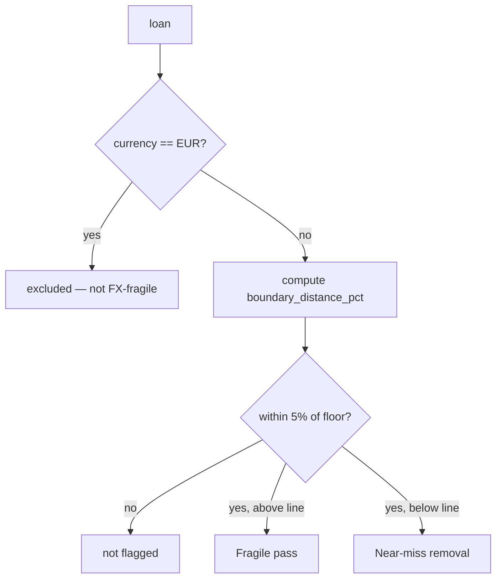

# Engine 3 — Insight: FX-Boundary Fragility

> The first (and safest) insight built on top of the reporting layer. It surfaces
> **non-EUR loans sitting close to the €25,000 Rule 1 threshold** — the ones a
> small currency move could flip — as a **fragility signal on today's rates**, not
> a prediction. It reads `loan_value_eur` from `rule_results` and computes a
> distance. No new data, no model, no LLM in the numbers.
>
> This is the concrete, decided version of the "Signal 1 — FX-boundary distance
> (anomaly lens)" idea from the broader
> [Insights & Report proposal](./Insights_and_Report.md). It is the piece being
> built first because it needs nothing new and carries no forecasting liability.

---

## Table of contents

1. [Scope & design principle](#1-scope)
2. [Why fragility, not prediction](#2-why)
3. [The computation](#3-computation)
4. [The two groups](#4-groups)
5. [The UI: an Insights tab](#5-ui)
6. [The AI summarizer boundary](#6-summarizer)
7. [Data required](#7-data)
8. [Locked design decisions & rationale](#8-locked)

---

<a name="1-scope"></a>
## 1. Scope & design principle

This insight answers one question for a compliance officer: **which loans are
structurally fragile — one small FX move from flipping their Rule 1 status —
regardless of today's verdict?**

It keeps the same boundary the whole system rests on. Engine 1: the pipeline
computes, OPA decides. Engine 2: the agent decides what to do, deterministic tools
decide what's true. This adds nothing that decides — it is **pure arithmetic over a
number OPA's pipeline already produced** (`loan_value_eur`). The AI summarizer on
the tab *narrates* the result; it never computes or predicts a value.

> **One-line defense:** *"This is a distance calculation on data we already have —
> it flags loans near the reporting floor. It makes no claim about where rates will
> go, so there's no probabilistic verdict to defend."*

---

<a name="2-why"></a>
## 2. Why fragility, not prediction

There are three different things people call "forecasting" here, and only the first
two are defensible:

- **Asset-value predictor** — inferential ML (predict a missing value), the brief's
  named stretch goal, evaluated with RMSE. Real, but separate from this doc.
- **FX scenario / fragility** — deterministic: apply a hypothetical move, or measure
  distance to the threshold. No model, nothing to be "wrong" about. **This doc.**
- **FX rate prediction** — predicting where EUR/USD will actually go, then forecasting
  "this loan will pass in N days." **Deliberately rejected.**

Rate prediction was rejected for concrete reasons: short-horizon FX is close to a
random walk (notoriously unforecastable), it would need external historical FX data
we don't have, and — most importantly — it reintroduces a *probabilistic claim about
a compliance outcome* into a system whose entire strength is that every verdict is
deterministic and defensible. "This loan will probably pass Thursday" is the one kind
of output we cannot stand behind, because the input (future FX) cannot be known.

So we surface **distance to the floor**, and let the human read the fragility. The
loan's status still comes only from the observed rate on the day of the check — the
rate remains a thing we *observe*, never a thing we *predict*.

---

<a name="3-computation"></a>
## 3. The computation

For every loan, the distance from the €25,000 threshold as a percentage:

```
boundary_distance_pct = (loan_value_eur - 25000) / 25000
```

- Positive → currently passes (above the floor); negative → currently fails (below).
- **Flag** any loan where `abs(boundary_distance_pct) <= 0.05` (the 5% band).

Two scoping rules make the flag meaningful:

- **Non-EUR loans only.** A EUR loan near €25,000 is *near the line but not fragile*
  — EUR can't move against EUR, so its distance is fixed. Only loans whose original
  `loan_currency` ≠ EUR are genuinely rate-sensitive, so only those are flagged.
- **Both sides of the line**, kept separate (see next section).



The "move to flip" shown per loan is simply `abs(boundary_distance_pct)` — the size
of the move it would take, framed conditionally ("≈2.8% adverse"), never as a
prediction that it will happen.

**Band:** fixed at **5%** (€23,750–€26,250). Not a live UI toggle. If 5% flags too
few loans to be useful, widen to 10% — a config change, not a user control.

---

<a name="4-groups"></a>
## 4. The two groups

Same computation, opposite signs, but they mean different things to a reviewer, so
they are shown as two separate tables:

- **Fragile passes (just above the floor).** Pass today and sit *in* the report, but
  a small EUR strengthening would push them under €25,000 and they'd wrongly remain
  reported. **The operationally important group** — the bank is relying on these, and
  they're fragile.
- **Near-miss removals (just below the floor).** Fail today and are being removed, but
  by a thin margin — a small favourable move would clear them, so they may not be
  genuinely out of scope. Useful context rather than urgent.

The sign carries the meaning; do not merge them into one "near the threshold" bucket.

---

<a name="5-ui"></a>
## 5. The UI: an Insights tab

A dedicated **Insights** tab in the app (between Compliance and Review), matching the
existing styling. Layout, top to bottom:

1. **AI insight summary** — a card with a **"Generate summary" button** (not
   auto-generated), matching the Review group-summary pattern. On click it produces a
   short narrative over the tables below.
2. **Context strip** — non-EUR only, within 5% of €25,000, with three counts:
   near-floor total, fragile passes, near-miss fails. States plainly that EUR loans
   are excluded and that this is today's fragility, not a forecast.
3. **Two tables** — "Fragile passes" (above) and "Near-miss removals" (below). Each
   row: `loan_id`, company, currency, EUR value, **signed Δ to floor %**, and the
   **"≈X% adverse / favourable" move-to-flip** column. Each table shows "X of N" so
   sparseness at 5% is visible.

Wording in the UI is always conditional — *"would need a ≈X% move to flip"* — never
*"will pass/fail."*

---

<a name="6-summarizer"></a>
## 6. The AI summarizer boundary

The summarizer replaces a chatbot on this tab, but stays strictly in its lane:

- It **narrates the deterministic tables** — which loans are fragile, where the
  exposure concentrates (e.g. "USD-booked loans from 3 companies"), and the one-line
  caveat. It is the same boundary as the Review group summaries.
- It **computes nothing and predicts nothing.** Every fact in the summary traces to a
  row in the table below it. The LLM never becomes a source of numbers, and never
  says a loan will flip.
- It is **button-triggered** (an explicit, on-demand LLM call), consistent with the
  rest of the app, and wires into the same LLM seam as Engine 2 (Grok now → Azure
  OpenAI later).

---

<a name="7-data"></a>
## 7. Data required

**None beyond what Engine 1 already produces.** The insight reads `loan_value_eur`
and `loan_currency` from `rule_results`, applies a constant threshold and a distance
formula, and filters. It ties into the FX stamp Engine 1 already records
(`fx_source`, `fx_rate_date`, `fx_stale`) so the fragility can be shown as
"based on ECB rates from [date]." No external fetch, no historical FX series, no
model, no training.

This is exactly why it is built first: maximum insight for near-zero cost and zero
new liability.

---

<a name="8-locked"></a>
## 8. Locked design decisions & rationale

| # | Decision | Rationale |
|---|---|---|
| 1 | Surface distance-to-floor (fragility), never a rate prediction | Future FX is unforecastable; a "will pass" claim can't be defended in a deterministic system |
| 2 | Non-EUR loans only | EUR loans can't move against EUR — near the line but not fragile |
| 3 | Both sides of the line, shown as two separate tables | Fragile passes and near-miss removals mean different things; the sign carries meaning |
| 4 | Fixed 5% band, widen to 10% only if too sparse; not a live toggle | Keeps the signal simple and reviewable; band is a config choice, not a user control |
| 5 | Distance column framed as "≈X% move to flip", conditional wording | It's a margin, not a forecast; never state "will pass/fail" |
| 6 | AI summary is button-triggered and only narrates the tables | Consistent with Review; the LLM never computes or predicts a number |
| 7 | Reads existing `loan_value_eur`; no new data, model, or fetch | Pure arithmetic over what OPA's pipeline already produced — built first for zero cost |
| 8 | Ties to the run's FX stamp (source / date / stale) | Fragility is anchored to the rates actually used, and is reproducible per run |

---

### Relationship to the other engines & the report

This is one insight in the broader reporting layer. It sits alongside (but is
independent of) the **asset-value predictor** (the brief's named stretch, built
before any invented insight) and the **downloadable compliance report**, both
described in [Insights_and_Report.md](./Insights_and_Report.md). It changes nothing
in Engine 1 (verdicts) or Engine 2 (remediation) — it only reads what they produced
and does arithmetic a human can check by hand.
