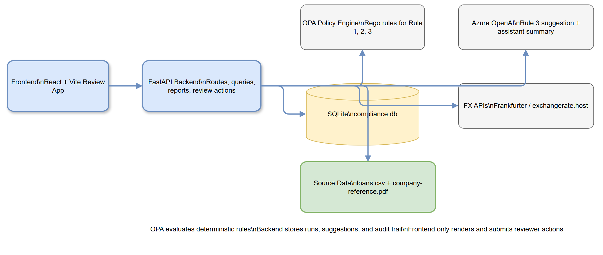
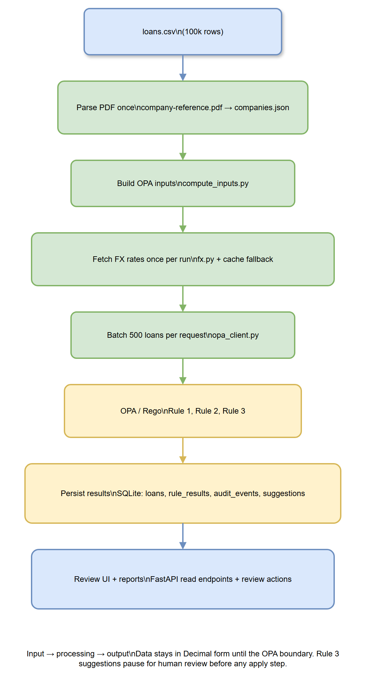
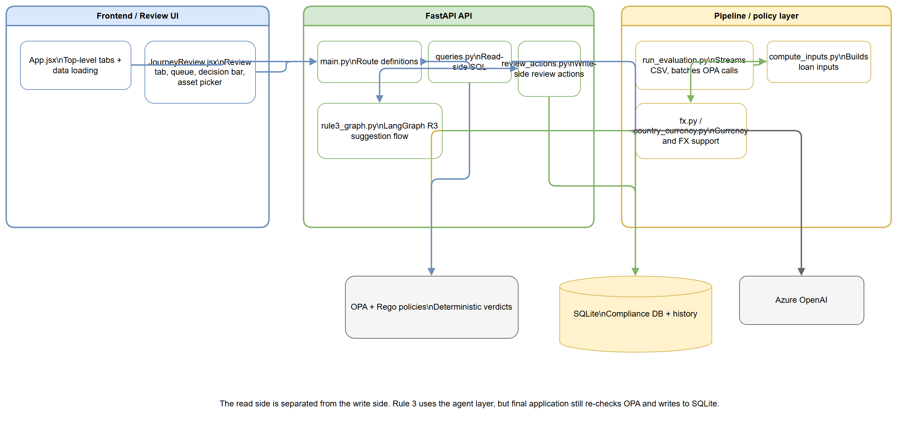

# BIL-Loan-Approver — Project Summary

## Executive Summary

BIL-Loan-Approver is an agentic loan-compliance system that reviews pledged loans against three deterministic rules before they are reported. It combines a Python/FastAPI backend, a React/Vite frontend, an OPA/Rego rule engine, SQLite persistence, and an AI-assisted Rule 3 remediation flow for substitute collateral suggestions.

The system is designed around a strict separation of concerns. The pipeline computes rule inputs, OPA makes the pass/fail decision, the review layer records human actions, and the UI gives reviewers a fast queue with manual, ignore, and accept-suggestion workflows.

The project is optimized for a large dataset. `loans.csv` is streamed in batches, FX rates are cached per run, PDF company data is parsed once into `companies.json`, and review/report endpoints query SQLite instead of reloading everything into memory.

## Architecture Overview



[Editable diagram source](diagrams/high-level-architecture.drawio)

BIL-Loan-Approver has five main layers: the React review/dashboard app, the FastAPI API surface, the deterministic evaluation pipeline, the remediation/assistant layer, and the persistence and policy layers underneath. OPA runs as a separate container and evaluates the Rego rules, while the backend stores runs, review decisions, audit history, and generated suggestions in SQLite.

The architecture intentionally keeps rule decisions out of the model layer. Rule 1 and Rule 2 are fully deterministic; Rule 3 uses retrieval plus an LLM only to suggest substitute collateral, then pauses for human review before anything is applied.

## Processing Pipeline



[Editable diagram source](diagrams/processing-pipeline.drawio)

The evaluation path is a batch pipeline. `run_evaluation.py` streams `loans.csv`, loads or builds `companies.json`, fetches FX rates once per run, computes OPA inputs for each loan, sends batches of 500 loans to OPA, and persists results to SQLite.

Rule 1 uses converted EUR values, Rule 2 uses a country-to-currency lookup derived from the company reference data, and Rule 3 uses the pledged asset value compared with the loan value in the original currency. The same company reference data later powers the review UI and the Rule 3 asset picker.

## Core Components



[Editable diagram source](diagrams/component-relationships.drawio)

### Backend API

| Component | Responsibility |
|---|---|
| `backend/app/main.py` | FastAPI routes for dashboard, review, history, reports, assistant, and run triggers |
| `backend/app/queries.py` | Read-side SQL for queues, summaries, history, and per-loan detail views |
| `backend/app/reports.py` | PDF and CSV report generation |
| `backend/agent/review_actions.py` | Applies reviewer decisions and writes audit updates |
| `backend/agent/rule3_graph.py` | LangGraph flow for substitute-asset suggestion |

### Evaluation Pipeline

| Component | Responsibility |
|---|---|
| `backend/pipeline/run_evaluation.py` | Orchestrates the full evaluation pass |
| `backend/pipeline/compute_inputs.py` | Builds OPA-ready loan inputs |
| `backend/pipeline/fx.py` | Loads FX rates with fallback caching |
| `backend/pipeline/country_currency.py` | Static country-to-currency lookup |
| `backend/pipeline/opa_client.py` | Sends batches to OPA |
| `backend/pipeline/parse_pdf.py` | Parses the company reference PDF into `companies.json` |
| `backend/pipeline/db.py` | Creates and migrates SQLite tables |

### Frontend

| Component | Responsibility |
|---|---|
| `frontend/src/App.jsx` | Root shell, tab navigation, and global data loading |
| `frontend/src/JourneyReview.jsx` | Review experience for rule failures and human-in-the-loop actions |

## API Contracts / Message Schemas

### Review detail response

`GET /api/review/loan/{loan_id}` returns a per-loan object used by the review panel. Important fields include:

| Field | Meaning |
|---|---|
| `run_id` | Active evaluation run |
| `id`, `co`, `hq`, `industry`, `ccy` | Loan identity and company context |
| `value`, `valueNum` | Loan amount for display and calculations |
| `rule_failed` | Rule currently being reviewed |
| `fix` | Suggested fix payload from the backend |
| `reasoning` | Human-readable explanation from the agent or deterministic fallback |
| `assets` | Rule 3 company asset list for manual selection |
| `via` | Whether the suggestion came from `llm` or `fallback` |
| `computed` | Whether a suggestion has already been computed |
| `evidence` | Supporting evidence links and page references |
| `impact` | Recheck scope after decision |

### Rule 3 asset shape

Rule 3 asset entries include these properties:

| Field | Meaning |
|---|---|
| `name` | Asset description |
| `value` | Asset value in the company currency |
| `qualifies` | Whether the asset clears the 50% threshold |
| `coverage` | Coverage ratio against the loan value |
| `current` | Whether this is the pledged asset already on the loan |
| `pdfPage` | PDF page number for the company reference entry |

### Review actions

`POST /api/review/{loan_id}/rule1/decide`, `rule2/decide`, and `rule3/decide` accept reviewer actions. The Rule 3 flow supports a human gate: generate the suggestion first, then apply it only after review. Batch endpoints follow the same pattern for large review passes.

## Infrastructure & Deployment

The OPA policy engine runs in its own container via [docker-compose.yml](docker-compose.yml). The backend is a FastAPI application run with Uvicorn, and the frontend is a Vite app that proxies `/api` requests to the backend during local development.

The runtime data lives in `data/` and is intentionally regenerated: `compliance.db`, `fx_cache.json`, and `companies.json` are created or refreshed as the pipeline runs. The source inputs are the loan CSV and the company reference PDF.

## Extension Patterns

If you add a new backend read view, place it in `backend/app/queries.py` and expose it through `backend/app/main.py` as a thin route wrapper. If you add a new mutation or review action, put the write logic in `backend/agent/review_actions.py` so review decisions stay centralized and auditable.

If you add a new deterministic rule, implement the rule in `backend/policies/`, compute any required inputs in `backend/pipeline/compute_inputs.py`, and keep the rule evaluation itself inside OPA. If the rule needs human-facing remediation, add the suggestion logic in the agent layer and surface it through the review UI.

If you extend the Review tab, update `frontend/src/JourneyReview.jsx`. That file already owns the loan detail panel, rule-specific review states, batch review flow, and the manual Rule 3 asset picker.

## Rules & Anti-Patterns

- Keep rule verdicts deterministic.
- Do not call the LLM to answer Rule 1 or Rule 2.
- Do not fabricate data that is not present in the source PDF or CSV.
- Do not load the full dataset into the browser at once.
- Do not let the UI apply a Rule 3 suggestion without a visible human-review step.
- Keep FX conversion and country lookup in the pipeline, not in Rego.
- Keep read-side SQL separate from write-side review actions.

## Dependencies

| Layer | Dependencies |
|---|---|
| Backend | FastAPI, Uvicorn, python-dotenv, requests, truststore, pdfplumber, python-multipart, pytest, reportlab, langgraph, langchain-openai, openai |
| Frontend | React, React DOM, Vite, lucide-react, papaparse, recharts, Tailwind CSS tooling, oxlint |
| Policy engine | Open Policy Agent (OPA) with Rego policies |
| Storage | SQLite |
| Reporting | ReportLab |

## Code Structure

```text
BIL-Loan-Approver/
├── backend/
│   ├── app/
│   ├── agent/
│   ├── pipeline/
│   ├── policies/
│   └── tests/
├── frontend/
│   └── src/
├── DOCS/
│   └── (original design/spec documents)
├── docs/
│   ├── diagrams/
│   └── project-summary.md
├── data/
│   └── (runtime cache and database artifacts)
├── docker-compose.yml
└── Hackathon Brief/
    └── BRIEF.md
```

## Notes

This summary is based on the code in the workspace, not on assumptions. The existing `DOCS/Architecture.md` file contains a more detailed mermaid overview of the same system, while this document is intended to be the shareable project summary that can be exported to Word.
