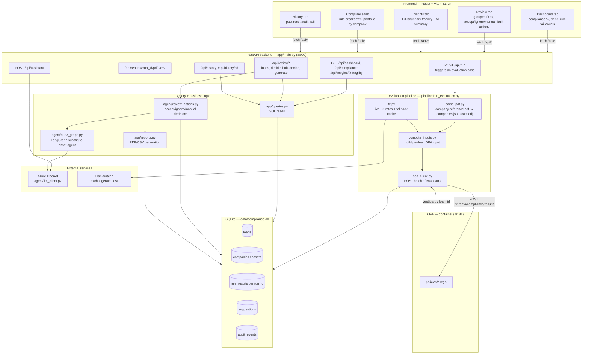

# BIL-Loan-Approver

Loan Compliance Review Agent is an Agentic AI system that validates secured loans against compliance rules before reporting. Failed loans are routed to human reviewers with three actions: manually fix the issue, ignore the exception, or approve an AI-generated correction, ensuring compliant, auditable, and efficient loan processing.

## 1. What this is

A bank has given out ~100,000 secured loans, each pledged against a company
asset. Before those loans can be reported, every one of them must pass three
deterministic compliance rules. Anything that fails is routed to a human
reviewer, who sees exactly what failed and why, and picks one of three
actions:

1. **Fix manually** — edit the value themselves.
2. **Ignore** — leave it as is, logged as a reviewed exception.
3. **Accept the AI-suggested fix** — apply what the agent proposed.

The three rules are enforced by an **OPA/Rego policy engine** — never by a
model's judgement. An LLM only gets involved where a real decision has to be
made (choosing a substitute collateral asset for Rule 3); Rules 1 and 2 are
pure deterministic lookups/conversions with no agent in the loop at all.

## 2. The three rules

| # | Rule | Pass condition | On failure |
|---|------|-----------------|------------|
| **1** | Minimum loan value | `loan_value_eur > 25,000.00` (converted from `loan_currency` at the day's FX rate) | No fix exists — suggest **remove from report** |
| **2** | Currency must match HQ country | `actual_currency == expected_currency` (HQ country from the reference PDF, resolved via a static country→currency table) | Suggest the **correct currency** for that country |
| **3** | Asset coverage | `asset_value >= 0.5 * loan_value` (same currency, no conversion) | Agent looks up the company's other pledgeable assets and suggests a **substitute asset** that clears 50%; if none exist, says so honestly instead of forcing a fix |

Each rule is a small `.rego` policy under [backend/policies](backend/policies):
[rule1_min_value.rego](backend/policies/rule1_min_value.rego),
[rule2_currency.rego](backend/policies/rule2_currency.rego),
[rule3_coverage.rego](backend/policies/rule3_coverage.rego), composed by
[main.rego](backend/policies/main.rego). The pipeline computes every input a
policy needs (converted EUR value, expected currency, etc.); OPA only ever
compares numbers/strings to a threshold — it never fetches data or calls a
model.

## 3. Architecture



A full write-up of every subsystem lives in [DOCS/Architecture.md](DOCS/Architecture.md),
with deeper per-engine specs in [DOCS/Evaluation_Engine.md](DOCS/Evaluation_Engine.md)
(the OPA pipeline) and [DOCS/Action_Engine.md](DOCS/Action_Engine.md) (the
agent/remediation layer).

### Key design decisions

- **Rules are Rego, not model judgement.** Every verdict is deterministic and
  reproducible; the pipeline only computes the inputs (FX-converted EUR
  value, expected currency, coverage ratio) and OPA does the comparison.
- **The LLM only decides where there's a real decision.** Rule 1's fix
  ("remove from report") and Rule 2's fix (a table lookup) need no agent at
  all and are plain Python in [review_actions.py](backend/agent/review_actions.py).
  Rule 3 (picking a substitute collateral asset) is the one place an LLM
  makes a judgement call, implemented as a small [LangGraph](backend/agent/rule3_graph.py)
  graph: deterministic retrieve/filter tools → LLM selects + explains →
  a **human-review interrupt** (the graph pauses and cannot apply anything
  without an explicit reviewer decision) → apply → OPA re-check.
- **Retrieval is exact lookup, not embeddings.** Company names match 1:1
  between `loans.csv` and the reference PDF, so Rule 3's "RAG" step is a
  structured dictionary lookup ([tools.py](backend/agent/tools.py)) rather
  than a vector search — simpler, deterministic, and verified to have zero
  mismatches across the dataset.
- **Money is always `Decimal`, never `float`**, right up to the OPA request
  boundary, so FX conversion and coverage-ratio comparisons never drift at
  the exact threshold being graded.
- **Never fabricate data.** If a piece of information doesn't exist in the
  source PDF/CSV (e.g. an asset's owner, dropped as "noise" by the parser),
  the UI says so explicitly rather than inventing a plausible-looking value.
- **Streamed, not loaded.** `loans.csv` (~100k rows) is streamed and
  evaluated in batches of 500 against OPA, and persisted to SQLite
  incrementally — never held fully in memory.
- **Idempotent runs.** `companies`/`assets` reference tables are upserted,
  `rule_results` is keyed by `(loan_id, run_id)` so past runs are preserved
  for the History tab, and only one evaluation run may be active at a time.

## 4. Repository structure

```
BIL-Loan-Approver/
├── docker-compose.yml        # OPA server (Podman/Docker container, :8181)
├── data/                     # loans.csv, company-reference.pdf, companies.json
│                             # (parsed cache), compliance.db (SQLite), fx_cache.json
├── backend/
│   ├── app/
│   │   ├── main.py           # FastAPI routes (thin — logic lives in queries/review_actions)
│   │   ├── queries.py        # All SQL read logic (dashboard, review queue, history...)
│   │   └── reports.py        # PDF/CSV report generation
│   ├── pipeline/              # Engine 1: loans.csv -> OPA -> SQLite
│   │   ├── run_evaluation.py  # Orchestrator (streams CSV, batches of 500)
│   │   ├── parse_pdf.py       # company-reference.pdf -> companies.json (cached)
│   │   ├── compute_inputs.py  # Builds each loan's OPA input fields
│   │   ├── country_currency.py# Static country -> currency table
│   │   ├── fx.py               # Live FX rates with fallback chain
│   │   ├── opa_client.py       # Batch client for OPA's REST API
│   │   └── db.py               # SQLite schema + connection management
│   ├── agent/                  # Engine 2: remediation / human-in-the-loop
│   │   ├── review_actions.py   # Applies accept/ignore/manual decisions, re-checks OPA
│   │   ├── rule3_graph.py      # LangGraph: the one place an LLM makes a judgement call
│   │   ├── tools.py            # Deterministic retrieval/filter tools the agent calls
│   │   └── llm_client.py       # Single seam for all Azure OpenAI calls
│   ├── policies/                # Rego policies evaluated by OPA
│   │   ├── main.rego
│   │   ├── rule1_min_value.rego
│   │   ├── rule2_currency.rego
│   │   └── rule3_coverage.rego
│   └── tests/                   # pytest suite
├── frontend/
│   └── src/
│       ├── App.jsx             # Dashboard / Insights / Compliance / History tabs
│       └── JourneyReview.jsx   # Review tab: per-rule review UI, batch actions
├── DOCS/                        # Design specs (Architecture, Evaluation Engine,
│                                 # Action Engine, Report generation, Insights/FX)
└── Hackathon Brief/              # Original assessment brief + loans.csv sample
```

## 5. Tech stack

| Layer | Technology |
|-------|------------|
| Rule engine | [Open Policy Agent](https://www.openpolicyagent.org/) (Rego), run as a container via `docker-compose.yml` |
| Backend API | Python, FastAPI, uvicorn |
| Evaluation pipeline | Plain Python (`pdfplumber` for PDF parsing, `requests` for FX rates, `Decimal` arithmetic throughout) |
| Agent / remediation | [LangGraph](https://github.com/langchain-ai/langgraph), Azure OpenAI (`openai` SDK) |
| Storage | SQLite (`data/compliance.db`) |
| Reports | ReportLab (PDF), CSV (streamed) |
| Frontend | React 19 + Vite, `lucide-react` icons, `recharts`, Tailwind CSS |
| Tests | pytest |

## 6. Running it locally

### Prerequisites
- Python 3.11+, Node.js, and Podman or Docker.
- A `.env` file at the repo root with the Azure OpenAI credentials used by
  `backend/agent/llm_client.py`:
  ```
  AZURE_OPENAI_ENDPOINT=...
  AZURE_OPENAI_KEY=...
  AZURE_OPENAI_API_VERSION=...
  AZURE_OPENAI_CHAT_MODEL=...          # optional, defaults to gpt-5.4-mini
  AZURE_OPENAI_ORCHESTRATOR_MODEL=...  # optional, defaults to gpt-5.4
  ```

### 1. Start OPA
```powershell
podman compose up -d      # or: docker compose up -d
```
Runs the OPA server on `:8181`, with `backend/policies` mounted read-only.

### 2. Start the backend
```powershell
cd backend
pip install -r requirements.txt
uvicorn app.main:app --reload --port 8000
```
`GET /api/health` should return `{"status": "ok"}`. On first request, run the
evaluation pipeline once via `POST /api/run` (or `python -m pipeline.run_evaluation`)
to populate `data/compliance.db` from `data/loans.csv`.

### 3. Start the frontend
```powershell
cd frontend
npm install
npm run dev
```
Opens on `:5173`; `/api/*` calls are proxied to the FastAPI backend (see
`frontend/vite.config.js`).

### Tests
```powershell
cd backend
python -m pytest tests/ -q
```

## 7. API overview

| Method | Path | Purpose |
|--------|------|---------|
| `GET`  | `/api/health` | Liveness check |
| `POST` | `/api/run` | Trigger a fresh evaluation pass over `loans.csv` |
| `GET`  | `/api/dashboard` | Compliance %, trend, per-rule fail counts |
| `GET`  | `/api/compliance` | Rule breakdown + portfolio value by company |
| `GET`  | `/api/insights/fx-fragility` | Loans near the Rule 1 FX boundary |
| `POST` | `/api/insights/fx-fragility/summary` | AI narration of the FX-fragility insight |
| `GET`  | `/api/review/summary` / `/api/review/stages` | Review-queue counts by rule |
| `GET`  | `/api/review/loans` | Paginated, filterable review queue for one rule bucket |
| `GET`  | `/api/review/loan/{loan_id}` | Full detail for one loan's review panel |
| `POST` | `/api/review/{loan_id}/rule1/decide` | Accept / manual / ignore for Rule 1 |
| `POST` | `/api/review/{loan_id}/rule2/decide` | Accept / manual / ignore for Rule 2 |
| `POST` | `/api/review/{loan_id}/rule3/generate` | Run the Rule 3 agent up to its human-review gate |
| `POST` | `/api/review/{loan_id}/rule3/decide` | Accept / manual / ignore / remove for Rule 3 |
| `GET`  | `/api/review/rule3-wave` | Progress of the background Rule 3 suggestion wave |
| `POST` | `/api/review/rule3-wave/start` | Manually (re)start the Rule 3 background wave |
| `POST` | `/api/review/bulk-generate` | Generate (not apply) Rule 3 suggestions for a batch |
| `POST` | `/api/review/bulk-decide` | Apply a decision across a batch of loans |
| `GET`  | `/api/history`, `/api/history/{run_id}` | Past evaluation runs + audit trail |
| `GET`  | `/api/reports/{run_id}/pdf`, `/csv` | Generated compliance report |
| `GET`  | `/api/assets/company-reference.pdf` | Serves the source reference PDF (for evidence links) |
| `POST` | `/api/assistant` | Page assistant chat |

## 8. Further reading

- [DOCS/Architecture.md](DOCS/Architecture.md) — full system diagram and structural notes
- [DOCS/Evaluation_Engine.md](DOCS/Evaluation_Engine.md) — the OPA evaluation pipeline in depth
- [DOCS/Action_Engine.md](DOCS/Action_Engine.md) — the remediation agent layer
- [DOCS/Insights-FX.md](DOCS/Insights-FX.md) — FX-boundary fragility insight
- [DOCS/REPORT_GENERATION_SPEC.md](DOCS/REPORT_GENERATION_SPEC.md) — report layout spec
- [Hackathon Brief/BRIEF.md](Hackathon%20Brief/BRIEF.md) — the original project brief
